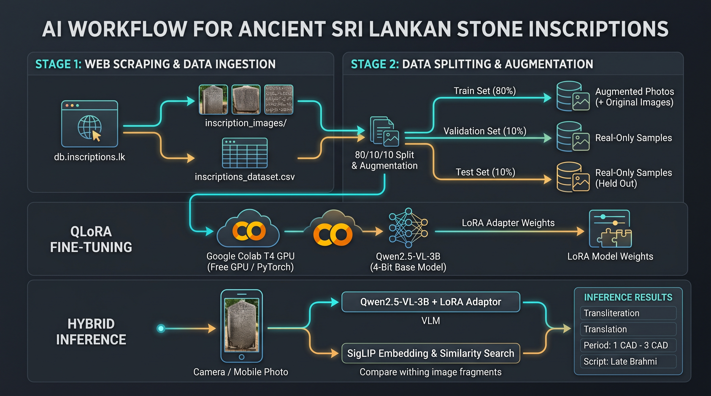
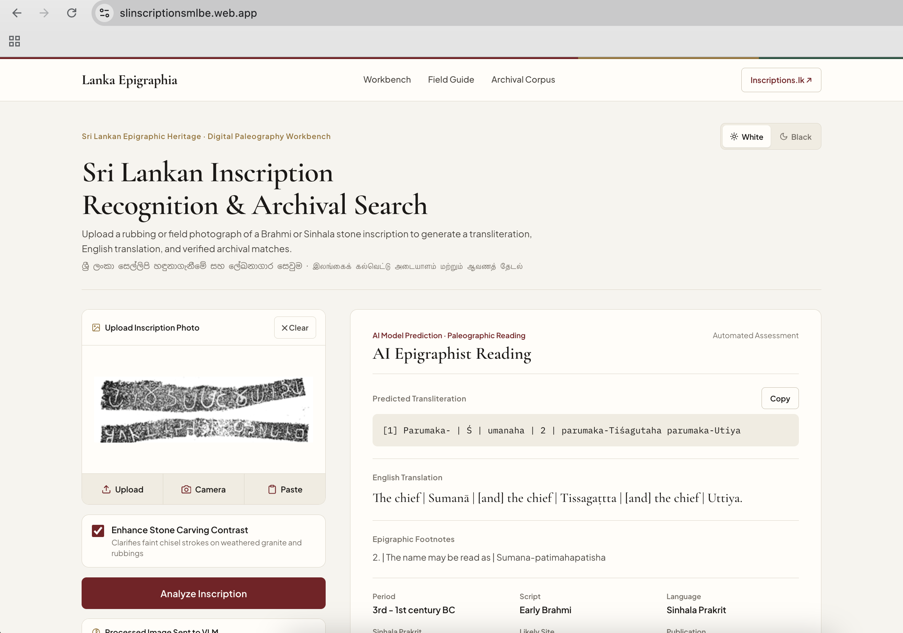
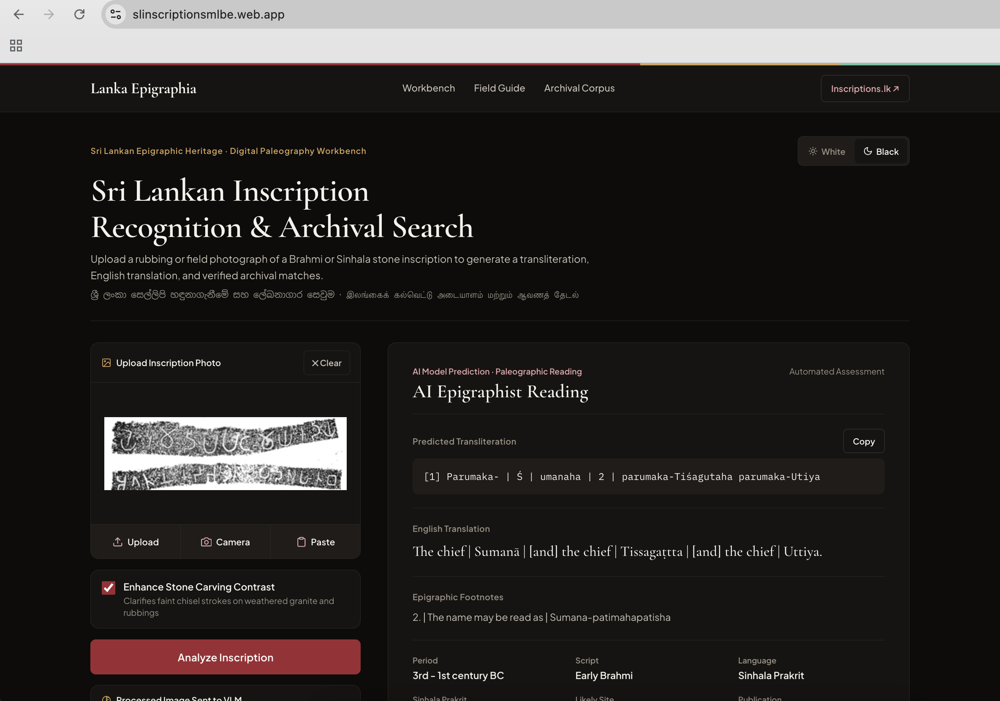
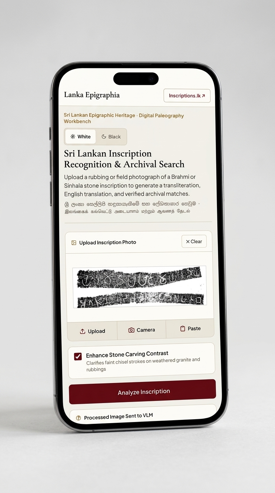

# 🏛️ Sri Lankan Inscription Recognition & Archival Search

[](https://slinscriptionsmlbe.web.app/)
[](https://huggingface.co/Qwen/Qwen2.5-VL-3B-Instruct)
[](https://db.inscriptions.lk)

> **Try the Live Application:** 👉 <a href="https://slinscriptionsmlbe.web.app/" target="_blank" rel="noopener noreferrer"><strong>https://slinscriptionsmlbe.web.app/</strong></a>
> Upload a rubbing or field photograph of an ancient Sri Lankan Brahmi or Sinhala stone inscription to get an instant AI transliteration, English translation, paleographic classification, and visually matched archival plates.
---

## ✨ Application & Training Showcase

### End-to-End Architecture & Workflow
<p align="center">
  
</p>

### Updated User Interface (Light, Dark & Mobile Views)
| Light Mode (`update_ui_light.png`) | Dark Mode (`update_ui_dark.png`) | Mobile Field View (`new_ui_mobile.png`) |
| :---: | :---: | :---: |
|  |  |  |

---

## 🔍 Overview & Architecture
Scattered across Sri Lanka’s cave drip-ledges, rock faces, and stone pillars are thousands of inscriptions dating back to the 3rd century BCE. Sourced from **[db.inscriptions.lk](https://db.inscriptions.lk)**, this project takes a specialized, limited-size historical dataset through the **complete AI engineering lifecycle**—from data curation and Vision-Language Model fine-tuning to a fast, low-cost serverless web app anyone can use in the field.

- **Domain Image Preprocessing:** Automatic contrast stretching (`autocontrast`) and edge sharpening tailored to weathered granite carvings and low-contrast estampage rubbings.
- **Fine-Tuned Vision-Language Model:** `Qwen/Qwen2.5-VL-3B-Instruct` merged with a custom LoRA adapter (`inscription_vlm_lora`) to generate structured JSON (transliteration, English translation, paleographic footnotes, script, period, and likely site).
- **Archival Visual Retrieval:** `google/siglip-base-patch16-224` cosine similarity search across digitized plates from `db.inscriptions.lk`, surfacing the top 3 verified historical matches alongside AI predictions.
- **Zero-Shot Input Guardrails:** `openai/clip-vit-base-patch32` classification + archival similarity thresholding (`>= 0.28`) to reject non-inscription photos before VLM inference.
- **Serverless Production Deployment:** Mobile-first dark-mode frontend on **Firebase Hosting** (`public/index.html`) backed by a containerized **FastAPI** service on **Google Cloud Run** (`backend/`) configured with scale-to-zero (`--min-instances 0`), per-IP rate limiting, and domain-locked CORS.

---

## ⚙️ End-to-End Execution Order (Data Collection to Deployment)

### Step 1: Data Collection (`pipeline/crawl_inscriptions.py`)
Crawls digitized inscription plates and epigraphic metadata from `db.inscriptions.lk`, saving raw images into `inscription_images/` and tabular records into `data/inscriptions_dataset.csv`.
```bash
python pipeline/crawl_inscriptions.py
```

### Step 2: Dataset Preparation & Augmentation (`pipeline/prepare_dataset.py`)
Applies contrast/rotation augmentations for low-resource generalization and splits the records (`80/10/10`) into structured prompt-response pairs (`data/train.jsonl`, `data/val.jsonl`, `data/test.jsonl`).
```bash
python pipeline/prepare_dataset.py
```

### Step 3: Vision-Language Model Fine-Tuning (`pipeline/train_vlm.py`)
Fine-tunes `Qwen/Qwen2.5-VL-3B-Instruct` using LoRA (executed on Google Colab GPU) and saves the lightweight adapter weights and tokenizer configs into `inscription_vlm_lora/`.
```bash
python pipeline/train_vlm.py
```

### Step 4: Held-Out Test Evaluation (`pipeline/evaluate_test.py`)
Evaluates the merged LoRA model against `data/test.jsonl` to benchmark JSON validity, transliteration accuracy, and period/script classification.
```bash
python pipeline/evaluate_test.py
```
## 📊 Model Evaluation Methodology & Results

To prevent data leakage and measure true generalization on unseen archaeological plates, the visual similarity index was restricted strictly to the training split (`848` embedded plates) during evaluation, and the fine-tuned `Qwen2.5-VL-3B` LoRA model was benchmarked on a strictly held-out test set of **15 real, non-augmented inscription plates** (`evaluate_test.py`). Each prediction was scored against ground-truth epigraphic records using **Character Error Rate (CER)** for Brahmi/Sinhala transliteration alongside exact-match classification accuracy for paleographic metadata.

| Evaluation Metric | Held-Out Test Score | Notes & Insights |
| :--- | :---: | :--- |
| **Language Classification Accuracy** | **66.67%** | Strong zero-shot recognition of Sinhala Prakrit / Old Sinhala inscriptions |
| **Script Classification Accuracy** | **66.67%** | Reliably distinguishes Early vs. Late Brahmi letterforms on legible rubbings |
| **Period Classification Accuracy** | **13.33%** | Fine-grained century/regnal dating remains challenging from visual carvings alone |
| **Transliteration CER (Overall)** | **84.64%** | Achieves ~54%–68% CER on clear estampage rubbings (e.g., `#391`, `#574`, `#1149`), while weathered/low-contrast plates that trigger guardrail rejections default to `1.000` CER |

> **Key Takeaway:** On high-contrast estampage rubbings, the model accurately identifies script family, language, and core lexical tokens (such as donor titles like *Parumaka*), whereas heavily weathered rock surfaces highlight why pairing VLM generation with `SigLIP` archival similarity retrieval provides crucial scholarly context.

### Step 5: Local Backend & Inference Testing (`backend/main.py` & `backend/predict_inscription.py`)
Starts the local FastAPI inference server (which loads the merged Qwen2.5-VL model, builds/loads SigLIP archival embeddings, and enables CLIP guardrails).
```bash
cd backend
uvicorn main:app --host 0.0.0.0 --port 8080 --reload
```

### Step 6: Production Backend Deployment on Google Cloud Run (`backend/Dockerfile` & `backend/cloudbuild.yaml`)
Builds the container image with pre-cached Hugging Face model weights and deploys to Cloud Run with scale-to-zero (`--min-instances 0`) and CPU throttling for minimal cost.
```bash
gcloud builds submit --config backend/cloudbuild.yaml backend/

gcloud run deploy inscriptions-api \
  --image gcr.io/<YOUR_PROJECT_ID>/inscriptions-api \
  --platform managed \
  --region us-central1 \
  --allow-unauthenticated \
  --memory 16Gi \
  --cpu 4 \
  --timeout 300 \
  --min-instances 0 \
  --max-instances 2 \
  --cpu-throttling
```

### Step 7: Frontend Deployment on Firebase Hosting (`public/index.html` & `firebase.json`)
Deploys the mobile-responsive single-page web interface to Firebase Hosting (`https://slinscriptionsmlbe.web.app/`).
```bash
firebase deploy --only hosting
```

---

## 📁 Repository Structure
```text
├── public/                 # Mobile-responsive dark-mode web UI (Firebase Hosting)
├── backend/                # FastAPI inference service, Dockerfile & Cloud Run config
├── pipeline/               # Data crawling (db.inscriptions.lk), 80/10/10 prep, LoRA training & eval
├── data/                   # Lightweight tabular metadata and train/val/test JSONL splits
├── inscription_vlm_lora/   # Fine-tuned LoRA adapter weights and tokenizer configs
├── docs/screenshots/       # Application UI and training screenshots
└── firebase.json           # Firebase Hosting deployment configuration
```

---

## 🙏 Acknowledgments & Limitations

* **Data Attribution:** The training dataset used in this project was sourced from **[db.inscriptions.lk](https://db.inscriptions.lk)**—all credit goes to their team for digitizing, cataloging, and preserving Sri Lanka’s epigraphic heritage.
* **Dataset Scale & Accuracy:** Because the model was fine-tuned on a relatively small, specialized corpus (~1,500 records), predictions on heavily weathered or unseen inscriptions may have limited accuracy. Scaling up with a larger, richly labeled dataset would significantly improve transliteration and translation precision.
* **Live Demo Performance:** The live web application is hosted on serverless free/scale-to-zero infrastructure purely for demonstration purposes. Please allow a brief cold-start warm-up time on your first request, and expect slightly slower inference speeds.
